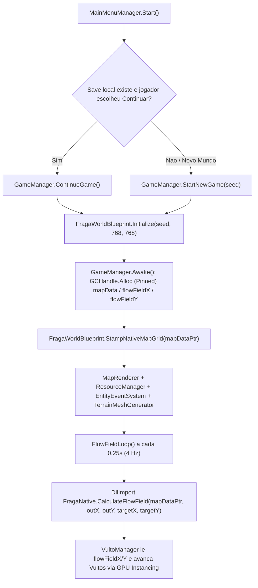
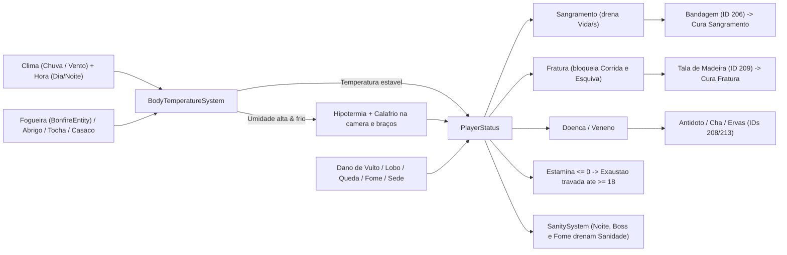
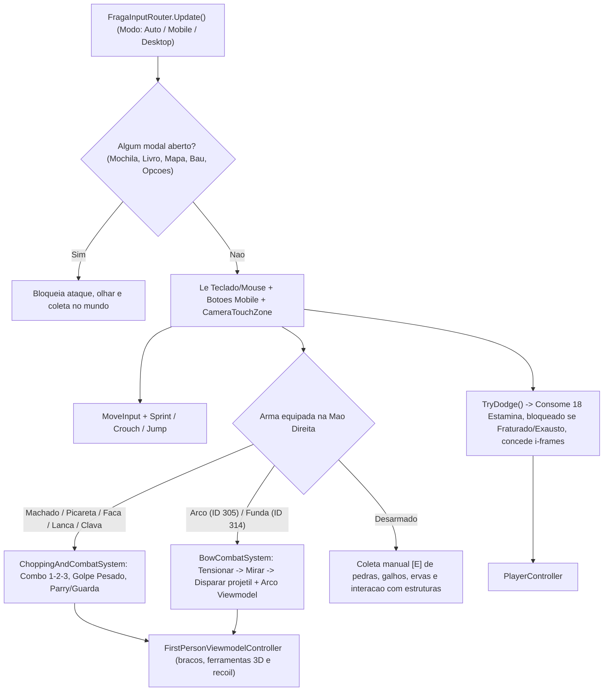
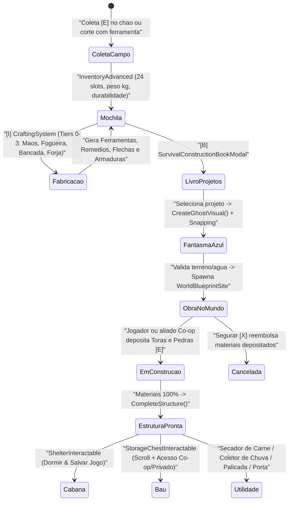
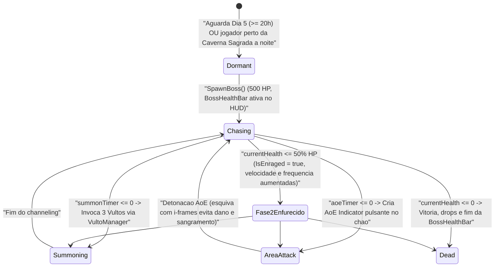
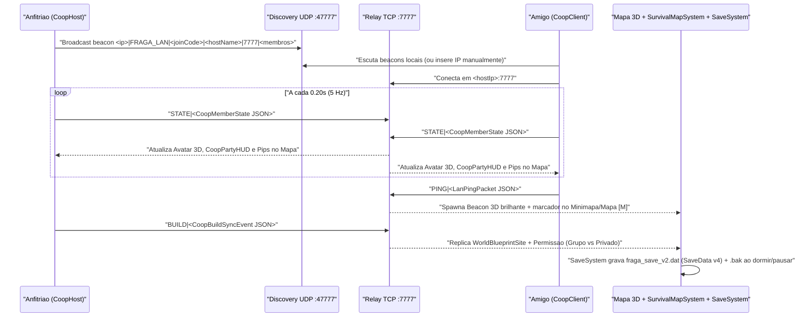

# Fluxogramas e Arquitetura de Sistemas — Fraga: A Noite Esquecida

Este documento apresenta os fluxogramas técnicos oficiais de funcionamento dos sistemas centrais do projeto, alinhados diretamente com os scripts C# em `Assets/Scripts/` e a ponte nativa C++ (`FragaNative`).

---

## 1. Boot do Mundo e Ponte Nativa C++ (FlowField 768x768m)

O [GameManager.cs](file:///C:/Users/Windows%2010/Fraga-Game/Assets/Scripts/GameManager.cs) fixa buffers gerenciados em memória (`GCHandleType.Pinned`) para permitir que a DLL/SO nativa `FragaNative` escreva o mapa e calcule o *FlowField* em C++ puro sem alocações no Garbage Collector do C#.

---

## 2. Fisiologia, Clima e Tratamento de Traumas

A sobrevivência integra clima ([WeatherSystem.cs](file:///C:/Users/Windows%2010/Fraga-Game/Assets/Scripts/WeatherSystem.cs)), ciclo dia/noite ([DayNightCycle.cs](file:///C:/Users/Windows%2010/Fraga-Game/Assets/Scripts/DayNightCycle.cs)), termorregulação ([BodyTemperatureSystem.cs](file:///C:/Users/Windows%2010/Fraga-Game/Assets/Scripts/BodyTemperatureSystem.cs)) e diagnóstico clínico em [PlayerStatus.cs](file:///C:/Users/Windows%2010/Fraga-Game/Assets/Scripts/PlayerStatus.cs) + [SurvivalInventoryCraftUI.cs](file:///C:/Users/Windows%2010/Fraga-Game/Assets/Scripts/SurvivalInventoryCraftUI.cs).

---

## 3. Roteamento de Input Híbrido (PC/Mobile) e Combate

O [FragaInputRouter.cs](file:///C:/Users/Windows%2010/Fraga-Game/Assets/Scripts/FragaInputRouter.cs) centraliza entradas de teclado/mouse e controles táteis ([MobileInputController.cs](file:///C:/Users/Windows%2010/Fraga-Game/Assets/Scripts/MobileInputController.cs) e [CameraTouchController.cs](file:///C:/Users/Windows%2010/Fraga-Game/Assets/Scripts/CameraTouchController.cs)), respeitando modais abertos (`IsGameplayInputBlocked`).

---

## 4. Ciclo de Inventário, Fabricação e Construção

O ciclo econômico conecta coleta de campo ([InventoryAdvanced.cs](file:///C:/Users/Windows%2010/Fraga-Game/Assets/Scripts/InventoryAdvanced.cs)), transformação de itens ([CraftingSystem.cs](file:///C:/Users/Windows%2010/Fraga-Game/Assets/Scripts/CraftingSystem.cs)) e canteiros modulares em mundo aberto ([BlueprintPlacementManager.cs](file:///C:/Users/Windows%2010/Fraga-Game/Assets/Scripts/BlueprintPlacementManager.cs)).

---

## 5. Ecossistema de IA, Diretor de Horda e Chefe Final

A ameaça da ilha escala dinamicamente entre fauna ([WildlifeAIEngine.cs](file:///C:/Users/Windows%2010/Fraga-Game/Assets/Scripts/WildlifeAIEngine.cs)), enxames sombrios instanciados na GPU ([VultoManager.cs](file:///C:/Users/Windows%2010/Fraga-Game/Assets/Scripts/VultoManager.cs)), o diretor de tensão ([HordeDirector.cs](file:///C:/Users/Windows%2010/Fraga-Game/Assets/Scripts/HordeDirector.cs)) e o chefe ([BossSystem.cs](file:///C:/Users/Windows%2010/Fraga-Game/Assets/Scripts/BossSystem.cs)).

---

## 6. Rede Co-op LAN/IP e Persistência (`SaveSystem`)

O multiplayer cooperativo roda de forma nativa em C# sem SDK externo pago via [FragaCoopSession.cs](file:///C:/Users/Windows%2010/Fraga-Game/Assets/Scripts/FragaCoopSession.cs) e [FragaLanCoopTransport.cs](file:///C:/Users/Windows%2010/Fraga-Game/Assets/Scripts/FragaLanCoopTransport.cs), enquanto a persistência usa [SaveSystem.cs](file:///C:/Users/Windows%2010/Fraga-Game/Assets/Scripts/SaveSystem.cs) com cópia de segurança `.bak`.

